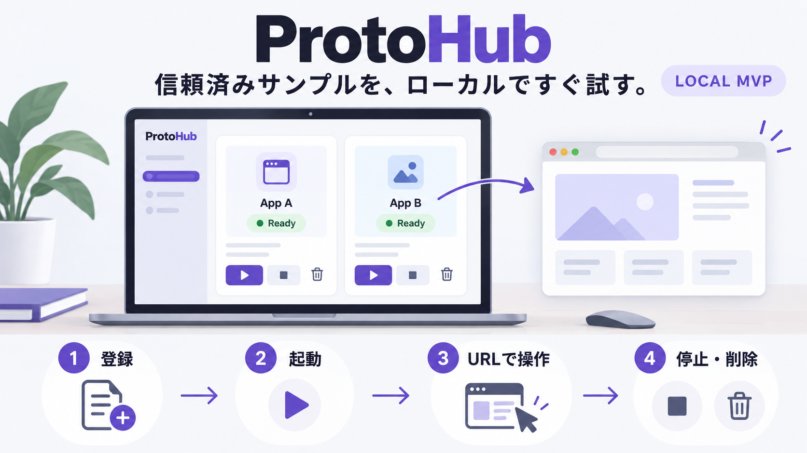
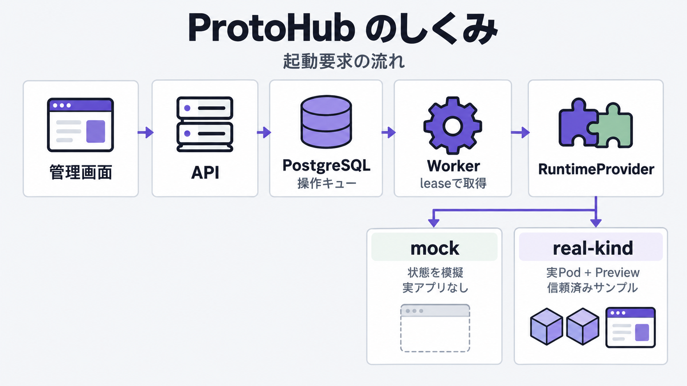

# ProtoHub

信頼済みの固定テンプレート `hello-web` を、管理画面から登録・起動・停止・削除する
localhost専用MVPです。Kubernetesのコマンドを知らなくても、サンプルを起動して試せます。



*コンセプト図（生成イラスト）。実画面や検証結果のスクリーンショットではありません。*

**登録 → 起動 → Ready → URLで操作 → 停止・再起動・削除** が基本の体験です。
real-kindではPod readinessと実HTTP応答を確認してからReadyを表示します。
アプリごとに実行資源を管理し、一方の停止・削除がもう一方に影響しない設計です。
停止は再利用のために実行を止め、削除はそのアプリの実行資源を除去します。
管理レコードはDBに保持します。

v0は単一開発者・信頼済みサンプルが対象です。対話しながらアプリを作る製品内AIは
[将来設計](docs/AI_DLC.md)として整理しています。開発者用のDevContainer・ハーネス・スキルは
このMVPの開発環境に含まれます。

実装・検証の到達点は [検証記録](docs/VALIDATION.md)、依存版は
[DEV_ENVIRONMENT](docs/DEV_ENVIRONMENT.md) を参照してください。

## しくみと実行モード



*構成図（生成イラスト）。起動要求の論理的な流れを示します。real-kindでは管理用の
web/API/worker/DB/previewもkind内に配置します。*

APIは操作要求と管理データをPostgreSQLへ保存し、別プロセスのworkerが期限付きleaseで
jobを取得して実行・観測します。管理データと操作キューはAPI/workerの再起動後も残ります。

| モード | 基盤 | サンプルの挙動 |
| --- | --- | --- |
| `mock` | Docker Compose | 状態遷移を模擬。実アプリを起動せず、preview URLも発行しない |
| `real-kind` | Docker上のkind | 実Podを起動し、Ready後にPreview経由でサンプルを操作する |

UIはReact/TypeScript/Vite、APIはFastAPI/Pydantic、DBはPostgreSQL/SQLAlchemy/Alembicです。
Redis、有料API、モデル接続は不要です。画像の生成方法・プロンプトは
[画像の説明](docs/images/README.md)、機能・API・状態の正本は [MVP仕様](docs/MVP_SPEC.md) を参照してください。

## 初回起動（WSL2）

WSL2 UbuntuのLinux filesystem上で作業してください。DockerのLinux daemon、Compose v2、
buildx、Git、Python 3.10以上、makeが必要です。real-kindにはkind、対応するkubectl、
**cgroup v2で動くDocker daemon**も必要です。`make doctor-kind` が事前に検査します。
Python/Nodeのアプリ依存は検証・ビルド用コンテナ内でuv/npmのlockfileからインストールします。
環境確認コマンドはOS設定変更や自動インストールを行いません。

この作業ブランチをWindows側からローカルに取り込む場合（pushは不要）:

```bash
mkdir -p ~/src
git clone --no-hardlinks --branch codex/protohub-local-mvp \
  /mnt/c/Git/ai-prototype-hub ~/src/ai-prototype-hub
cd ~/src/ai-prototype-hub
python3 harness/doctor.py --mode compose
make doctor
make up-mock
```

管理画面は [http://localhost:8080](http://localhost:8080) です。
mockでは画面に「Mock runtime — 実アプリは起動しません」を常時表示し、preview URLを発行しません。
登録・非同期操作・DB永続化を開発するモードです。

実際のサンプルを動かす場合は同じポートを使うmockを先に停止します:

```bash
make down
make doctor-kind
make up-real
```

real-kindは専用kindクラスタ`protohub-local`へweb/API/worker/preview/DBを配置します。
管理画面で登録→起動→Ready→「アプリを開く」の順に操作してください。
previewは `http://localhost:8081/apps/<UUID>/` です。サンプルのボタンを操作できます。
起動成功は現在generationのPod readiness、Deployment rollout、実HTTP応答から判定します。

Docker/WSLの起動・連携設定、ツール導入は [WSL_SETUP](docs/WSL_SETUP.md) を参照してください。
未知のcluster/context、既存ポート、所有記録のない資源を自動で再利用・削除しません。

## 日常の起動・停止

```bash
cd ~/src/ai-prototype-hub
make up-mock                 # Composeによる明示的mock
# または make up-real        # kindによる実起動。mockへフォールバックしない
make logs
make down                    # 自分のstackを停止。DB volumeとkind clusterを保持
```

同じモードを再起動すれば管理レコードを再利用します。停止はアプリの実行を止め、削除はそのアプリの
Pod/Deployment/Serviceとpreview経路を除去します。削除済みレコードは墓標としてDBに保持します。
TTLは起動成功時から60〜3600秒で計測し、期限で停止します。DBは削除しません。

ポート・資源名を分ける場合は、起動と以後の操作で同じ環境変数を使ってください:

```bash
export PROTOHUB_MODE=real-kind
export PROTOHUB_CLUSTER_NAME=protohub-personal
export PROTOHUB_CONSOLE_PORT=18080
export PROTOHUB_PREVIEW_PORT=18081
make up-real
make down
```

mockの資源名には`COMPOSE_PROJECT_NAME=protohub-personal`を使います。
全削除が必要なときだけ、表示対象と完全一致する名前を明示します（ローカルDBも失われます）:

```bash
PROTOHUB_MODE=real-kind PROTOHUB_CLUSTER_NAME=protohub-personal \
  PROTOHUB_RESET_CONFIRM=protohub-personal make reset-local
```

`reset-local`は通常の停止に使いません。全体pruneや他のcluster/volume削除は行いません。

## 開発と検証

各開発者のローカルPCでツール・依存・検査手順を揃える標準環境としてDevContainerを使います。
WSLのLinux側cloneをVS Codeで開き、
**Dev Containers: Reopen in Container** を実行できます。
Python/Node/uvとlockfileの依存を専用volumeへ用意し、non-rootで `make check-dev` を実行します。
初回設定・停止・再構築は [Dev Container手順](docs/DEV_CONTAINER.md) を参照してください。
アプリの `make up-mock` / `make up-real` と必須の `make verify` は、通常のWSLターミナルから実行します。
開発コンテナにはDocker socketやkubeconfigを渡しません。
現在の実測はWindows + WSL2 / Linux amd64です。他PC・macOS/Linux・ARMの確認状況と、
Docker/cgroup等のホストに残る条件も手順書へ記録しています。

この開発ハーネスには、タスクの目的・変更許可パス・担当・契約判断・修正予算を記録する
workflowと、実際の検査runnerを含めます。範囲外変更、既存変更の上書き、古いPASSの流用、
検証中のソース変更を検出し、必要な検査・独立レビューが揃わない完了を拒否します。
通常の工程ごとに承認を増やさず、OS・権限・課金・公開等の境界では既存の承認を守ります。
これは開発支援であり、OS sandboxの代替ではありません。

[開発ワークフロー](docs/DEVELOPMENT_WORKFLOW.md) と [導入スキル5件](docs/SKILLS.md) を参照してください。
スキルはプロジェクト内 `.agents/skills/` に配置し、固定した出所・ライセンス・hashを検査します。

```bash
# 以下はWSLホストの make check と組み合わせる例
make skills-check
python3 harness/workflow.py start --id ui-change \
  --objective '状態表示を改善する' --allow apps/web/ \
  --required-gate source --required-gate contracts --required-gate unit \
  --required-gate build --required-gate public-hygiene
WORKFLOW_ID=ui-change make workflow-check
```

Dev Container内のworkflowでは `source-host` / `contracts-host` / `unit-host` /
`build-host` と `harness-self` / `public-hygiene` をrequired gateへ指定し、
`make check-dev` の証跡を添付します。gate名はrunnerの実際のIDに合わせてください。

AI-DLCの原則はこの開発工程に採用しています。将来の対話型アプリ制作の段階・状態・成果物・
人の判断境界は [AI_DLC](docs/AI_DLC.md) に整理し、製品内のAI実行は次フェーズとして扱います。

```bash
make check          # lint/type/unit/contract/build/public-hygiene + harness自己検査
make integration    # 専用PostgreSQL fixtureでmigration/queue/並行性/復旧
make e2e            # 専用kind、実HTTP、Playwright、TTL、worker復旧、部分失敗
make security       # 別の専用kindで実RBAC allow/deny、Pod、Host/Origin/preview
make verify         # 上記の必須full gate。CIと同じ入口
```

結果は `.harness/reports/<run_id>/report.json` とgate別log/JUnitに保存します。
不足環境はBLOCKED、検査失敗はFAIL、必須skip/0 testsは非合格です。E2Eとsecurityは独立fixtureを
作成・検証・回収し、普段のstack選択を変更しません。中断時は猶予付きcleanupを行い、強制終了で
残った場合は同runの`fixture.json`と所有記録を確認して対象を限定したresetを行ってください。

Dockerを使わない補助検査もあります。これは実起動の合格を意味しません:

```bash
uv sync --project apps/server --locked
(cd apps/web && npm ci)
python3 harness/run.py --group portable
```

正本は [MVP仕様](docs/MVP_SPEC.md)、[OpenAPI](contracts/openapi.yaml)、
[契約変更記録](contracts/DECISIONS.md) です。API変更時は親担当が正本をレビューし、
`contracts/build_contract.py` と `npm --prefix apps/web run generate:api` で意図的に更新します。
通常検証は正本を書き換えず、実装OpenAPIとフロント型の差分を検出します。
分担・引継ぎは [PARALLEL_PLAN](docs/PARALLEL_PLAN.md)、`harness/handoffs/` を参照してください。

## 初期版の制約

- 単一開発者・localhost・固定`hello-web`テンプレートだけを対象とします。
- 悪性コード隔離、本番認証、インターネット公開には未対応です。local-dev principalは認証の代替ではありません。
- 任意Git/image/Dockerfile/command/env、ブラウザ内AI、外部LLMキーは受け付けません。
- kindの通常コンテナを安全な任意コードsandboxとして扱えません。対応CNIと実通信検証を伴うネットワーク隔離も未対応です。
- localhostのポートを分けてもCookieは分離されません。サンプルは認証Cookie・秘密を持ちません。
- AKS/Kata、OIDC/Entra ID、LiteLLM等は将来の差し替え対象です。今回クラウド資源を作成しません。
- リポジトリのライセンスは未選定です。依存パッケージのライセンスはそれぞれの配布元に従います。
