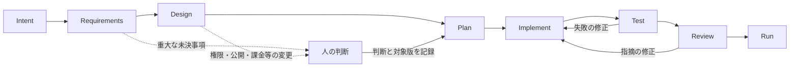

# ProtoHubでのAI-DLCの扱い

AI-DLCの考え方はProtoHubに合う。特に、目的と受入条件を先に揃え、設計・コード・
検証をつなぎ、途中から再開できる記録を残す点を採用する。現時点では開発工程に
取り入れ、ProtoHub内のAI開発機能は後続フェーズの設計として扱う。

AWSはAI-DLCを、AIが計画・具体化を進め、人が重要な判断を担う開発方法として説明し、
Inception、Construction、Operationsの3つの領域を示している。
要件や設計等の文脈をリポジトリに保存し、次の活動へ引き継ぐ点も含まれる。
[AWS公式解説](https://aws.amazon.com/blogs/devops/ai-driven-development-life-cycle/)

公式の `awslabs/aidlc-workflows` は、この方法論を実行する具体的なソフトウェアでもある。
調査時の実装はInitializationやIdeationも含む段階構成、状態管理、検証、承認の仕組みを
持つ。この文書の8段階はProtoHub向けの提案であり、上流の段階名をそのまま再実装した
ものでも、公式ランタイムへの完全準拠を宣言するものでもない。
[公式の段階説明](https://github.com/awslabs/aidlc-workflows/blob/676933ef69b04c5a662d644b62c09ed74aced896/docs/guide/04-phases-and-stages.md)

## 現在のリポジトリ開発に適用すること

今回のMVPは、仕様と契約を固定し、担当を分け、実装して、実検査と独立レビューで
修正する構成になっている。これを継続開発の基本にする。

| 目的 | ProtoHubで残すもの・実行するもの |
| --- | --- |
| 意図と範囲を共有する | `CODEX_TASK.md`、`docs/MVP_SPEC.md`、変更ごとの受入条件 |
| 担当間で契約を揃える | `contracts/openapi.yaml`、domain DTO、provider/job store契約 |
| 独立作業を分ける | `docs/PARALLEL_PLAN.md`、所有パス、共通base SHA、handoff |
| 再開できる状態を保つ | `harness/PLAN.md`、判断理由、未完項目、BLOCKED理由 |
| 結果を確認する | make/harnessからの実検査、今回runの証跡、独立レビューと修正 |

`.agents/skills/protohub-development/` は、この既存の入口を使うための開発手順にする。
別のqueueや検査runnerを重ねて作らず、詳細は [HARNESS_SPEC.md](HARNESS_SPEC.md) と
[SKILLS.md](SKILLS.md) に接続する。小さな修正は短い作業記録と影響検査で済ませ、
全変更に大きな設計書や段階儀式を強制しない。

通常の実装、失敗修正、再検証は与えられた依頼の範囲で続ける。人に戻すのは、
目的や仕様に重大な曖昧さがある場合と、OS設定・権限・秘密・課金・破壊操作・
外部公開等の判断境界に達した場合。工程が終わったという理由だけで確認を繰り返さない。

## 公式ランタイム全体を今入れない理由

上流のquick startはnative `aidlc` コマンドと各harness用runtimeを導入し、設定・hook・
承認手順まで扱う。単一の設計スキルを置くのとは導入範囲が違う。
[公式README](https://github.com/awslabs/aidlc-workflows/blob/676933ef69b04c5a662d644b62c09ed74aced896/README.md)

また、上流には承認の発生条件と自動進行の選択肢が定義されている。ProtoHubの
「通常工程での確認を繰り返さず、実装・修正を続ける」という依頼とどう接続するかを
評価せずに全面導入しない。上流の承認機構やCodexのsandboxを無効化して合わせることも
しない。必要になった時点で、特定版の導入内容・既存harnessとの重複・停止/復旧・
アンインストールを専用の検証環境で確認する。
[公式の進行・承認条件](https://github.com/awslabs/aidlc-workflows/blob/676933ef69b04c5a662d644b62c09ed74aced896/docs/guide/04-phases-and-stages.md#what-runs-in-order-and-what-runs-in-parallel)

## 将来のProtoHub内AI開発フロー案

ここからは設計案。現在のv0にAIエージェント、モデル呼出し、任意コードの生成・実行は
追加しない。v0は引き続き、信頼済み固定テンプレートを登録・起動・停止・削除する。

将来ユーザーが「作りたいもの」を渡し、成果物と検証を追える機能を作るなら、
次のような段階を候補にする。段階ごとの入力・出力を明示し、文章だけで成功状態を
進めない。これは前掲のAI-DLC原則から導いたProtoHub向けの設計判断である。

| 段階 | 主な成果物 | 次へ進む条件 |
| --- | --- | --- |
| Intent | 目的、対象利用者、今回の範囲、対象外 | 意図と未確定事項が区別されている |
| Requirements | 受入条件、制約、必要な人の判断 | 受入条件にIDがあり、検査へ結びつく |
| Design | API/データ/実行基盤の設計、権限・公開境界 | 契約と安全境界に矛盾がない |
| Plan | 依存関係付き作業単位、所有範囲、検証コマンド | 実行可能な計画と権限の範囲が定まる |
| Implement | ソース差分、build成果物、変更記録 | 対象作業が完了し、検査に渡せる |
| Test | 実行結果、SHA、mode、対象環境、証跡 | 必須検査がPASS。未実行はBLOCKED |
| Review | 独立した指摘、修正差分、再検証 | 重大な指摘が解消し、対応検査がPASS |
| Run | 許可された成果物の起動要求と実状態 | workerによる実観測。起動受付とReadyを分ける |

この図は全段階での承認要求を意味しない。既に許可された範囲の通常遷移は自動で
進め、仕様の選択や安全・費用の境界で必要な判断を求める。承認が必要な場合は、
対象と差分、費用や影響、次に起きる操作を確認できる状態にしてから提示する。

## 永続状態と実行境界

将来の実装では、会話履歴だけに進捗を持たせず、例えば次の管理単位を設ける。
名称・schemaの確定は次フェーズで行う。

- `WorkflowRun`：目的、範囲、現段階、実行policy、開始時のソース版。
- `WorkflowStep`：入力artifact版、担当、状態、attempt、lease owner/token、期限。
- `ArtifactRevision`：要件・設計・計画・コード等の版と内容hash、親子の依存関係。
- `EvidenceRecord`：実行コマンド、対象SHA、実mode、終了結果、証跡への参照。
- `DecisionRecord`：人の判断、対象の版・操作・権限範囲、有効条件。
- `WorkflowEvent`：遷移、再試行、cancel、BLOCKEDとその理由の記録。

段階の状態は `pending` / `running` / `waiting_input` / `waiting_approval` /
`succeeded` / `failed` / `cancelled` 等を候補とする。既存Sandboxの
`starting/running/stopped` や既存Operationの状態と混ぜない。
上流artifactが変わったら依存する検査・承認の有効性を確認し、古いPASSを流用しない。
判断待ちは、人の返答または既に記録した許可によって解消する。時間経過やAIの推測を
人の承認として扱わない。

実行制御は決定的な状態機械とDB transactionで持ち、AIの文章から直接Kubernetesへ
命令を送らない。段階jobにもlease token・世代・入力版の比較を適用し、cancelや
新しい計画の後に遅れた実行結果が確定しないようにする。

開発支援用のexecutorと、アプリ実行用の `RuntimeProvider` は責務を分ける。
AI実行側へworkerのServiceAccountやDocker socketを渡さない。外部モデルとの接続、
費用上限、秘密の保管、egress、生成コードのbuildと隔離、本番認証、公開先は、
それぞれ次フェーズで設計・許可・検証する。モデル名や有料APIをここでは選ばない。

次フェーズの受入条件には、段階再開、入力版変更による証跡の失効、lease回復、
古いholderの拒否、cancel、部分失敗、人の判断が必要な境界、UIでの状態表示を含める。
v0の実起動ゲートが完了してから、実装範囲を別の依頼として確定する。

## 参照した公式資料

調査日: 2026-10-30 JST。実装案はこのリポジトリの判断であり、導入済み機能の主張ではない。

- [AWS: AI-Driven Development Life Cycle](https://aws.amazon.com/blogs/devops/ai-driven-development-life-cycle/)
- [AWS: Adaptive Workflowsの公開説明](https://aws.amazon.com/blogs/devops/open-sourcing-adaptive-workflows-for-ai-driven-development-life-cycle-ai-dlc/)
- [awslabs/aidlc-workflows — 調査時commit](https://github.com/awslabs/aidlc-workflows/tree/676933ef69b04c5a662d644b62c09ed74aced896)
- [同リポジトリのMIT-0ライセンス](https://github.com/awslabs/aidlc-workflows/blob/676933ef69b04c5a662d644b62c09ed74aced896/LICENSE)

AI-DLC上流はMIT-0。今回は原則と設計上の参考に留め、そのruntimeをvendor/installしない。
